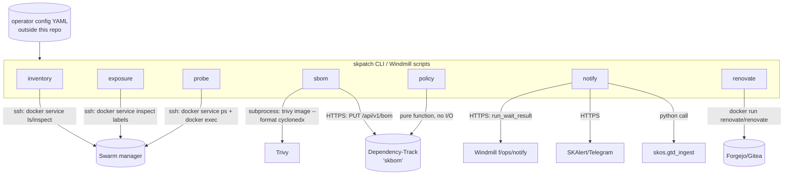
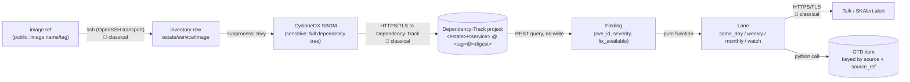
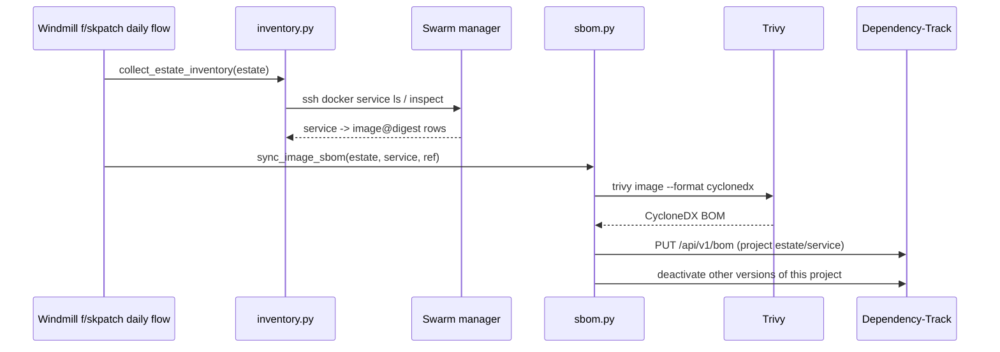

# skpatch - Standard Operating Procedures

The code home of the skpatch program: pin, inventory, scan and patch every
container image on a schedule. Dependency-Track (packaged by the operator as
"skbom") is the vulnerability register; Renovate runs as a Windmill flow
against the operator's Forgejo/Gitea. This repo owns the Python package, the
Windmill flow definitions, their tests, and the program's docs. It never
deploys anything itself.

## 1. Overview

`skpatch` answers one question on a fixed cadence: *is every running
container image pinned, scanned, and - if it has a known fix - patched on
time?* It owns:

- A read-only **inventory** of every running Swarm service's image and
  digest, and its **exposure** (public / behind an SSO gate / internal) from
  Traefik labels.
- **SBOM generation** (Trivy, CycloneDX) per image digest and upload to
  Dependency-Track, which does the actual CVE matching against NVD/GHSA/OSV
  on its own schedule.
- **Policy**: pure functions that turn a Dependency-Track finding plus an
  exposure class into a release lane (same day / weekly / monthly / watch).
- **Notification** fan-out (SKAlert/Telegram, Nextcloud Talk, unified GTD),
  every adapter optional and config-driven.
- **Renovate automation**, run as a container against the operator's own
  git host.
- An in-image **runtime floor probe** (e.g. catching a PHP version an image
  tag doesn't advertise), for the cases a tag or a CVE feed alone cannot see.

It explicitly does **not** own: applying a pin to a running service, the
release gate, tagging, forward-merging, or deploying (all `smilinTux/skstacks`
and its `v1/ansible/optional/skpatch` / `skbom` roles), or the concrete
hostnames, estate layout, and credentials any of the above run against (an
operator-owned config file outside this repo, see `examples/`).

**Start here:**
- `src/skpatch/cli.py` - every subcommand's entry point; read this first to
  see how the library modules compose.
- `src/skpatch/policy.py` - where a Dependency-Track finding becomes a
  same-day/weekly/monthly decision; the one module with no I/O at all.
- `src/skpatch/config.py` - the pydantic schema every `--config` file is
  validated against; read this before writing a config.
- `src/skpatch/inventory.py` + `exposure.py` + `probe.py` - the three
  read-only ssh-based modules, all built on `_remote.py`.
- `docs/skpatch-program.md` - the program as a whole: tools, cadence, the
  full policy table, and the release path.

## 2. Architecture

### Component view



### Data-flow



> Legend: 🟢 hybrid-pq · 🟡 symmetric · 🔴 classical (Shor-breakable, documented
> residual). `skpatch` is not a crypto component (T0 - N/A, no key material of
> its own); every hop above rides the transport's own TLS/SSH posture, which
> this repo does not alter and does not claim to harden.

**Data classification:** image references and inventory rows are
*internal*; SBOMs and Dependency-Track findings are *sensitive* (full
dependency trees and version data); credentials (API keys, bot tokens) are
*secret* and are never logged, printed, or committed.

### Sequence - daily inventory + SBOM sync



## 3. Build

Python 3.11+. No compiled artifact; the package is pure Python.

```bash
git clone https://github.com/smilinTux/skpatch
cd skpatch
python3 -m venv .venv && source .venv/bin/activate
pip install -e ".[dev]"
```

`pyproject.toml` declares runtime deps (`pydantic`, `PyYAML`, `click`,
`requests`) and dev deps (`pytest`, `black`, `mypy`). Format with
`black --line-length 110 src/ tests/`.

## 4. Test

```bash
python -m pytest tests/ -v
```

Every module has at least 3 tests (happy path, edge case, failure). No test
touches the network, a real ssh session, or a real Docker daemon:
`subprocess.run` and any HTTP session are always passed in as an injectable
argument, which a fake stands in for. When running inside a shared or
multi-session environment, scope pytest's temp directory to avoid colliding
with another run:

```bash
python -m pytest tests/ -v --basetemp=/path/to/your/own/scratch/pytest-basetemp
```

## 5. Release / Deploy

`skpatch` is a **library + CLI + Windmill flows**, not a long-running
service, so "deploy" means two things:

- **Build + publish** (library): bump `version` in `pyproject.toml`, add a
  `CHANGELOG.md` entry, tag `vX.Y.Z`, `pip install .` wherever the CLI runs
  (a nor worker, in the program design). No PyPI publish is wired up yet;
  the package is installed from a git checkout on the host that runs the
  scheduled jobs.
- **Windmill sync** (flows): `windmill/f/skpatch/` follows the `wmill sync`
  layout. From a machine with `wmill` configured against the `skops`
  workspace:
  ```bash
  wmill sync push --workspace skops
  ```
  This publishes the scripts and flows under the `f/skpatch` folder; the
  daily and weekly flows carry their own schedule in `flow.yaml` (see
  `windmill/f/skpatch/README.md`).

**Front-end / Exposure:** N/A - no network listener. The CLI and Windmill
scripts are invoked by a scheduler or an operator; Dependency-Track's own
`base_url` (configured by the operator, typically behind SSO) is the only
HTTP server this package talks to, never one it serves.

## 6. Configuration / Usage

Every real-world value (hostnames, estate names, credentials) lives in an
operator-owned YAML file outside this repo, validated against
`skpatch.config.EstateConfig`. Copy `examples/estate.example.yaml`
somewhere private (e.g. `~/.skcapstone/skpatch/config.yaml`) and fill it in.
See that file's comments for every key.

```bash
skpatch inventory --config ~/.skcapstone/skpatch/config.yaml
skpatch sbom --config ~/.skcapstone/skpatch/config.yaml --estate estate-a --service skhub-prod_nextcloud --image "nextcloud:34.0.4@sha256:<digest>"
skpatch policy --findings-file findings.json
skpatch renovate --config ~/.skcapstone/skpatch/config.yaml
skpatch probe --config ~/.skcapstone/skpatch/config.yaml --estate estate-a --service skhub-prod_nextcloud --image-repo nextcloud --manager mgr-a1.example
```

## 7. API / Reference

| Module | Key functions |
|---|---|
| `skpatch.config` | `load_config(path) -> EstateConfig` |
| `skpatch.inventory` | `collect_estate_inventory(estate, manager_hosts, ...) -> InventoryResult` |
| `skpatch.exposure` | `fetch_service_labels(...)`, `classify_exposure(labels) -> ExposureResult` |
| `skpatch.probe` | `probe_runtime(...) -> ProbeResult`, `load_floors(path)`, `runtimes_for_image(...)`, `evaluate(...) -> FloorCheck` |
| `skpatch.sbom` | `run_trivy_sbom(image, ...) -> dict`, `sync_image_sbom(...) -> SyncResult` |
| `skpatch.policy` | `Finding`, `Lane`, `classify_finding(f) -> Lane`, `classify_findings(list) -> dict`, `worst_lane(list) -> Lane \| None` |
| `skpatch.notify` | `notify_all(...) -> list[NotifyOutcome]`, `gtd_upsert_finding(...)` |
| `skpatch.renovate` | `run_renovate(config, ...) -> RenovateResult` |
| `skpatch.cli` | `inventory`, `sbom`, `policy`, `renovate`, `probe` subcommands of the `skpatch` entry point |

CLI: `skpatch --help` for the full option list per subcommand.

## 8. Troubleshooting

| Symptom | Check |
|---|---|
| `inventory` reports `unreachable: true` for an estate | Every host in that estate's `manager_hosts` timed out or refused ssh. Check `ssh -o BatchMode=yes <host> true` by hand from the same machine the job runs on. |
| `sbom` exits non-zero with "does not exist; provision the ... API key there first" | `dependency_track.api_key_file` doesn't exist yet. Create it (0600) with the Dependency-Track API key as its only content. |
| `probe` returns `runtimes: []` | No entry in `floors.yaml` matches the image repository substring. Add one; see `src/skpatch/data/floors.yaml`'s header comment. |
| A notify adapter never fires | Check the matching `*_credentials_file` key in your config actually points at an existing, complete env file. `notify_all` logs a warning and continues; it never raises, so check logs, not exceptions. |
| `renovate` run fails with a config error from the container itself | The container's own stderr is in `RenovateResult.stderr`; this module only builds the invocation, it does not validate Renovate's own config schema. |
| A test fails only in CI, not locally | Check `tests.yml`'s Python version matches yours; the suite has no network/host dependency so a CI-only failure is almost always an environment mismatch, not a flaky test. |

## 9. Maturity-tier + Version reference

**Maturity tier:** T0 - N/A (no key material; this package generates no
cryptographic material, performs no cryptographic operations, and relies
entirely on the transport security of ssh/TLS it does not implement).
**Version phase:** Incubating v1 (first public release). **Current SemVer:**
`0.1.0` (see `CHANGELOG.md`). No CRYPTOGRAPHY_STANDARD compliance statement
applies; see [SECURITY.md](SECURITY.md) for the full threat model.
